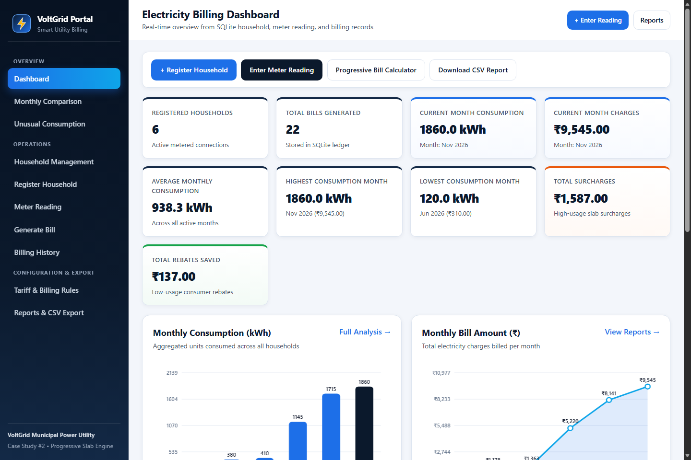
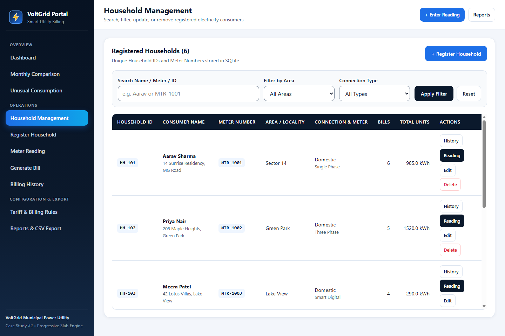
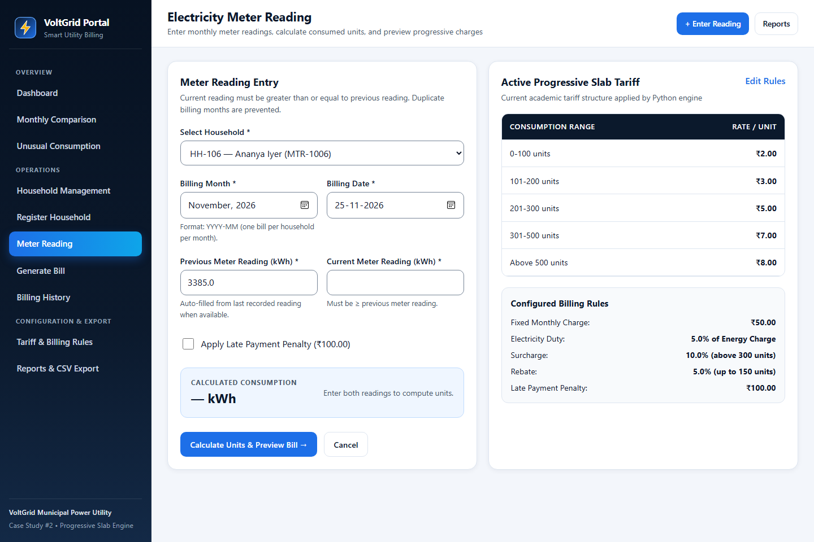
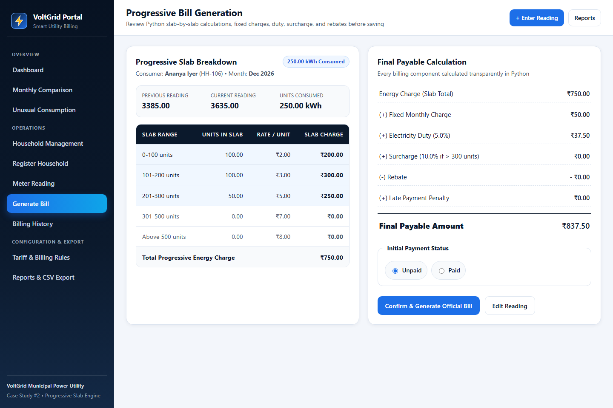
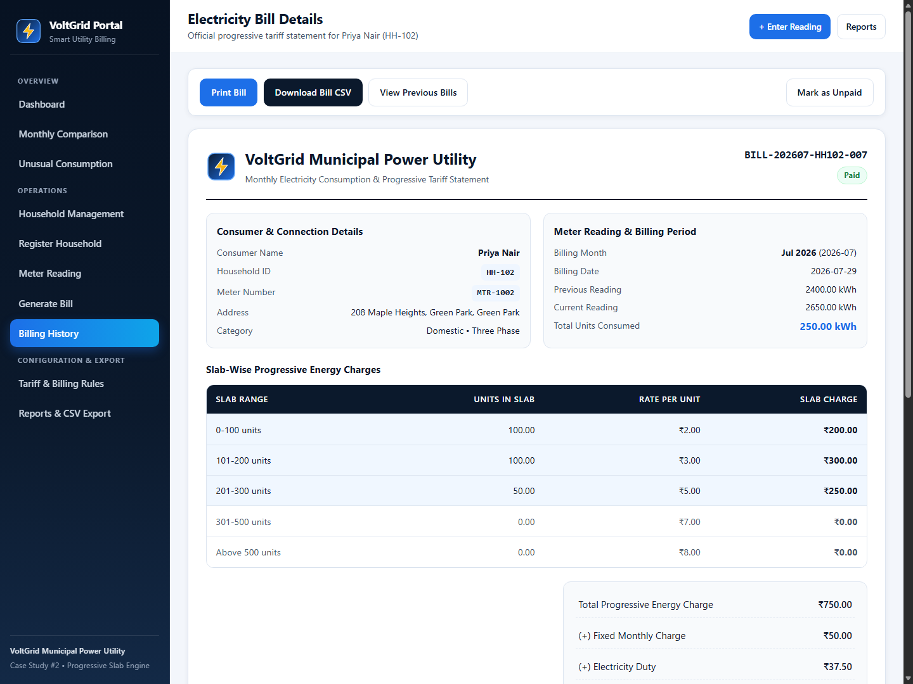
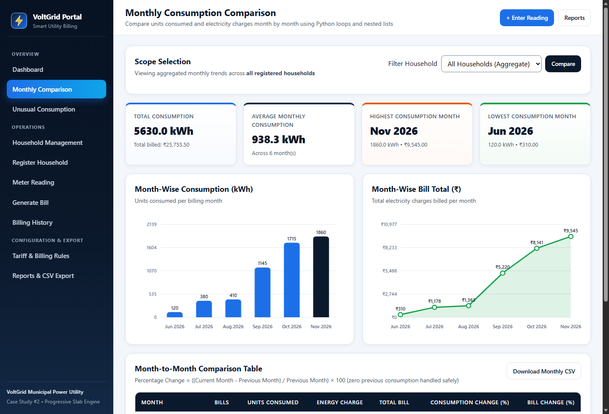
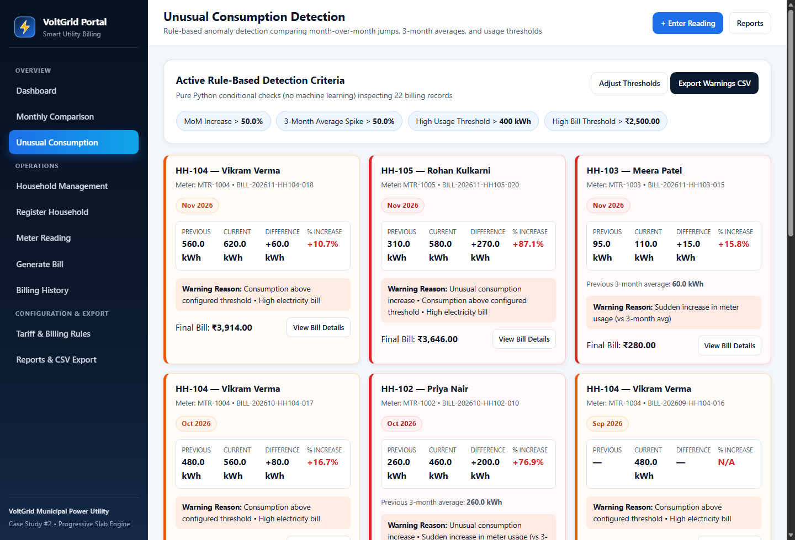
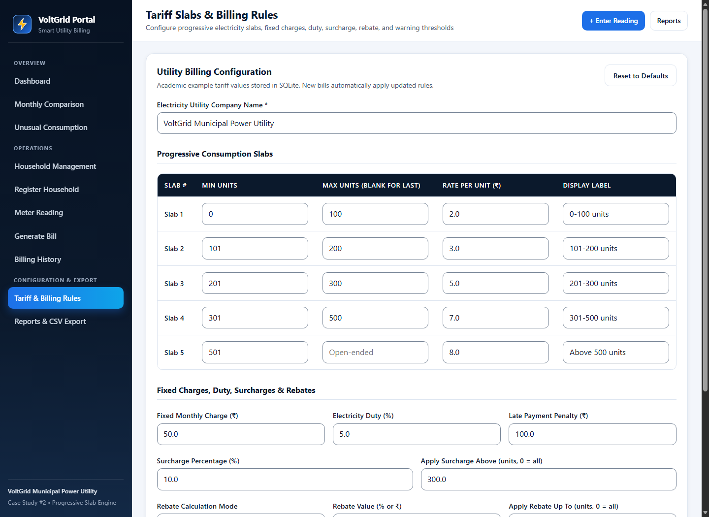
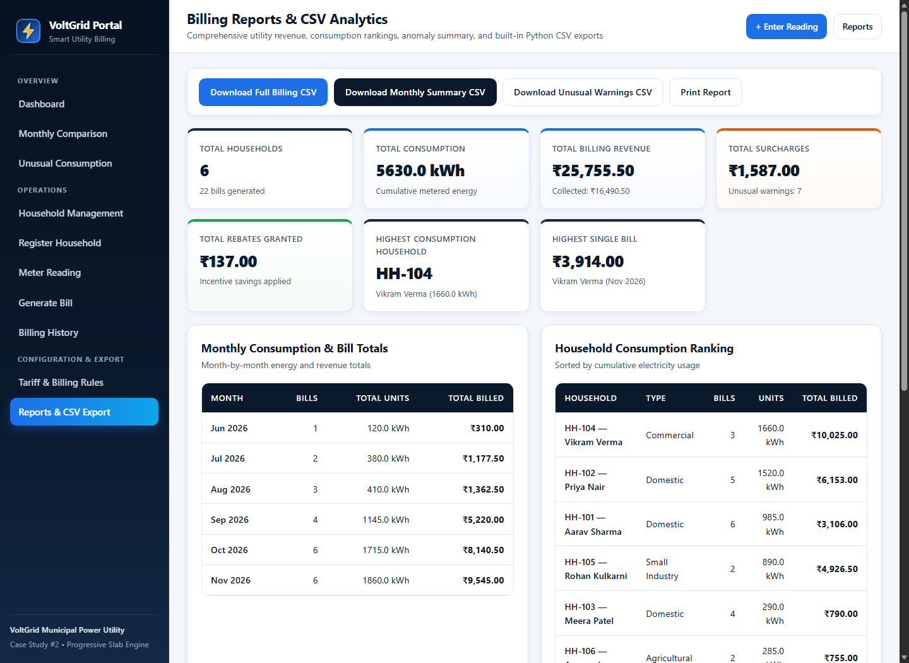
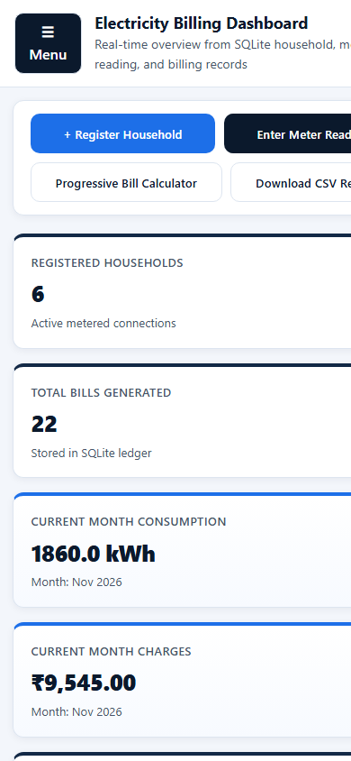

# Output Screenshots

Real application screenshots captured from the live **Progressive Electricity Billing and Monthly Consumption Analysis System** (`http://127.0.0.1:5001`):

1. **Dashboard Overview (Desktop):** 
2. **Household Management & Search Filters:** 
3. **Meter Reading Entry & Live Unit Calculation:** 
4. **Progressive Slab Calculator (250 Units Worked Example):** 
5. **Official Printable Bill Statement:** 
6. **Monthly Consumption Comparison & Charts:** 
7. **Rule-Based Unusual Consumption Detection:** 
8. **Configurable Tariff Slabs & Billing Rules:** 
9. **Reports, Python Pattern Summary & CSV Exports:** 
10. **Mobile Responsive Dashboard (390×844):** 
