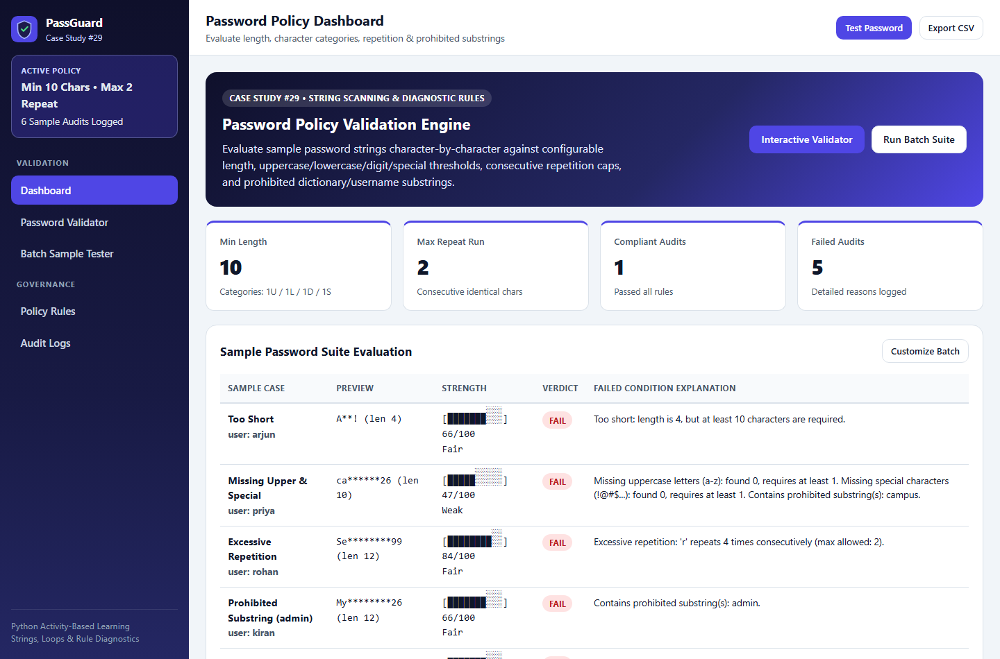
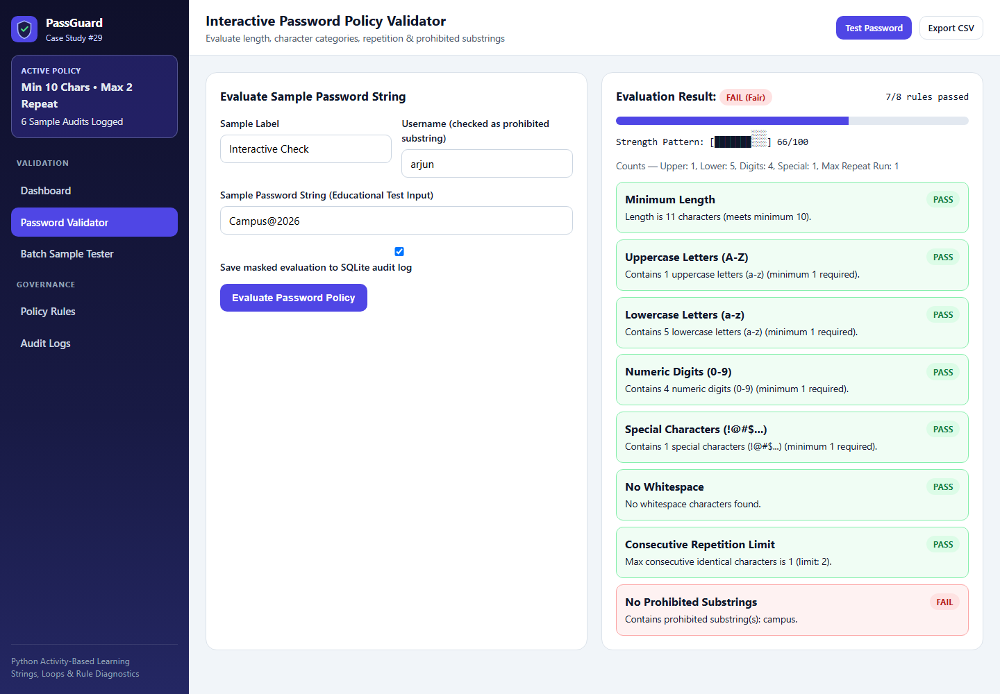
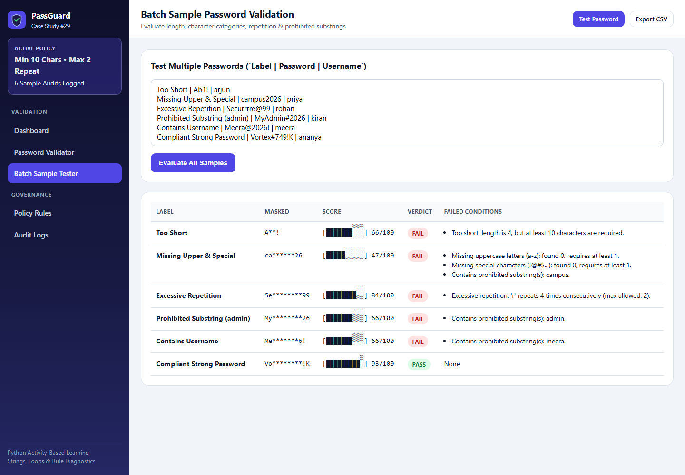
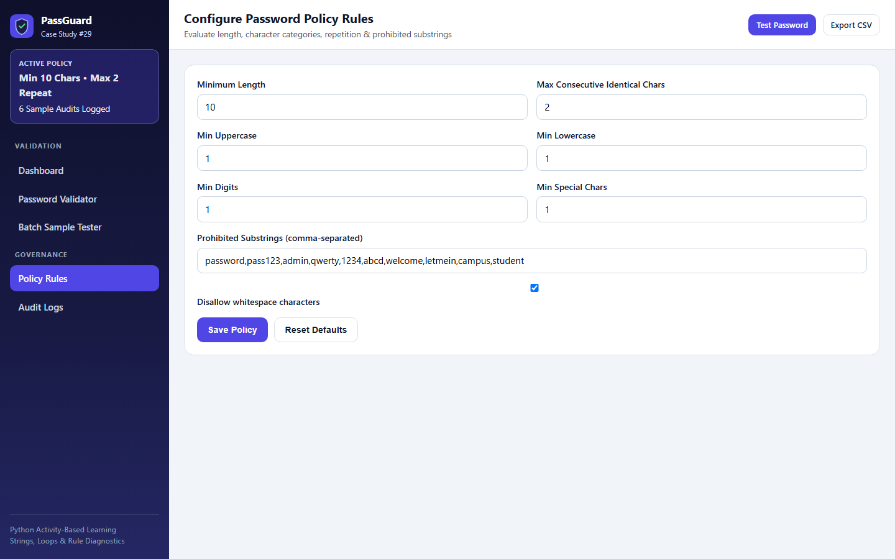
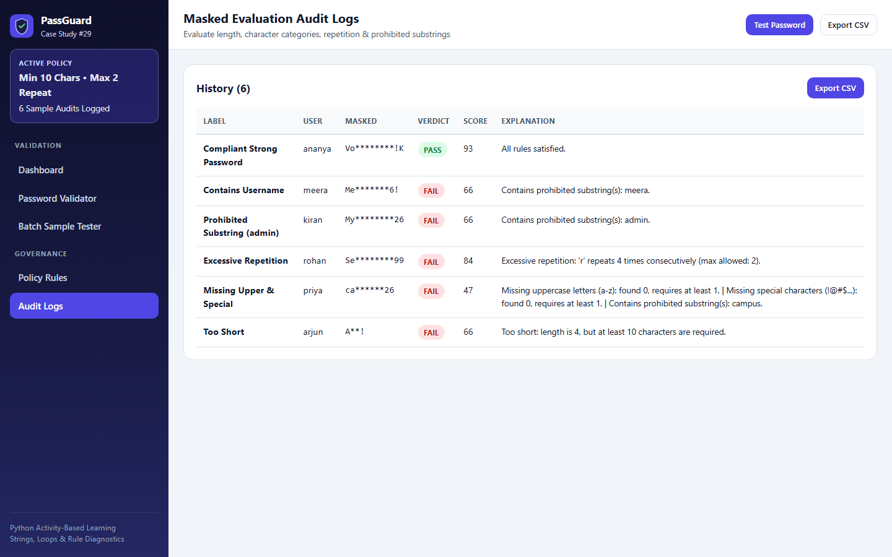
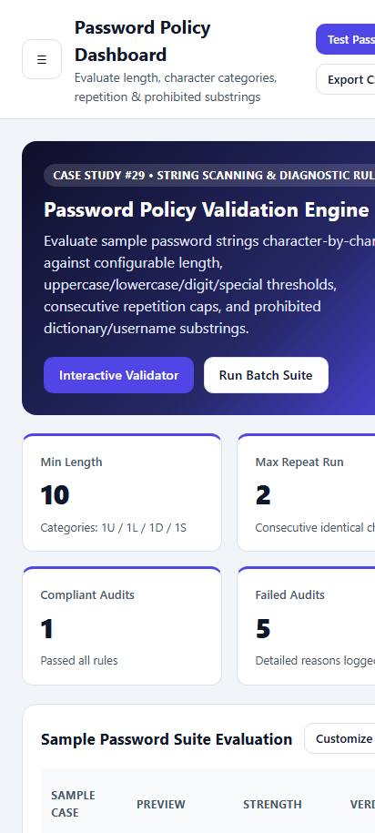

# Output Screenshots — password-validation-system

## 01_dashboard.png (`/`)

## 02_validator.png (`/validator`)

## 03_batch.png (`/batch`)

## 04_policy.png (`/policy`)

## 05_logs.png (`/logs`)

## 06_mobile_dashboard.png (`/`)

