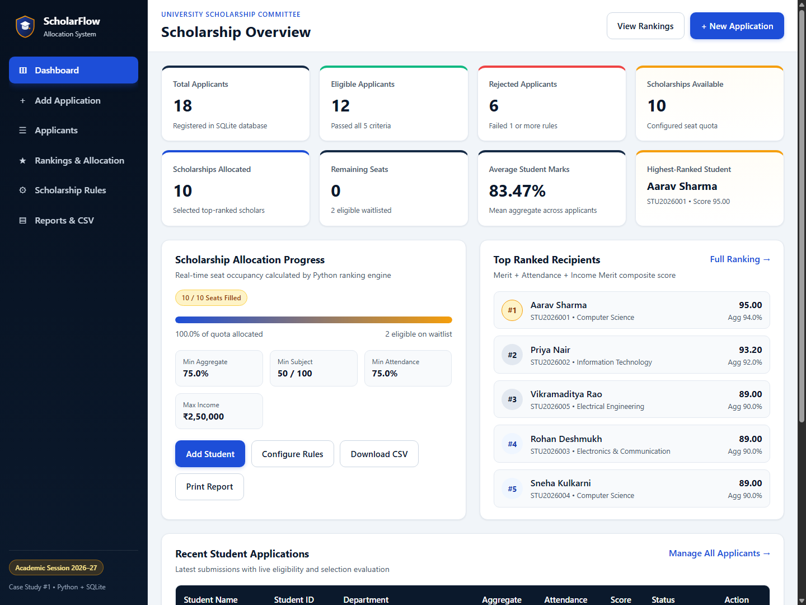
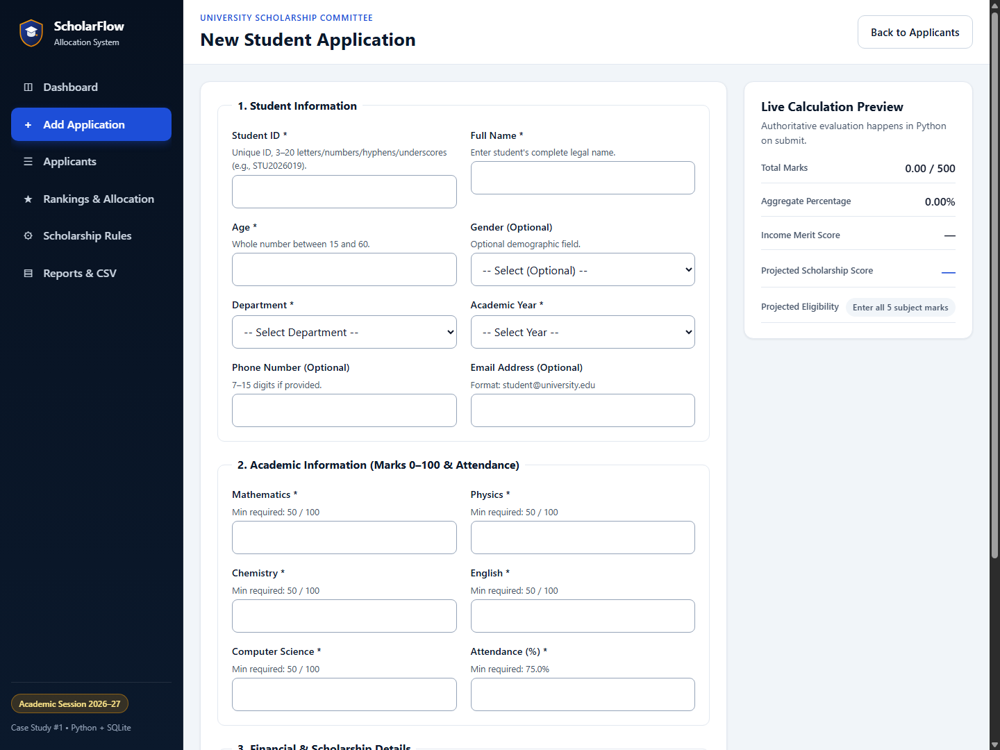
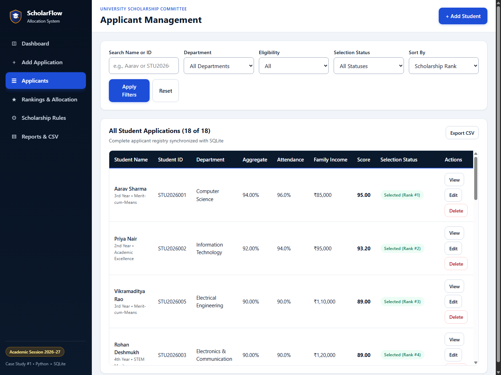
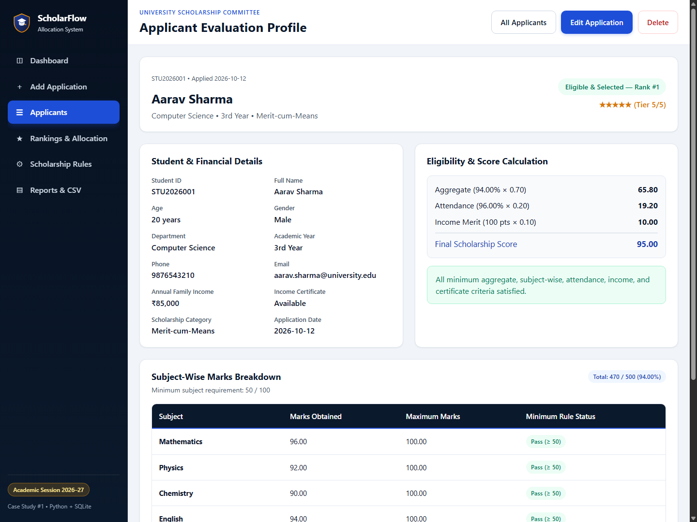
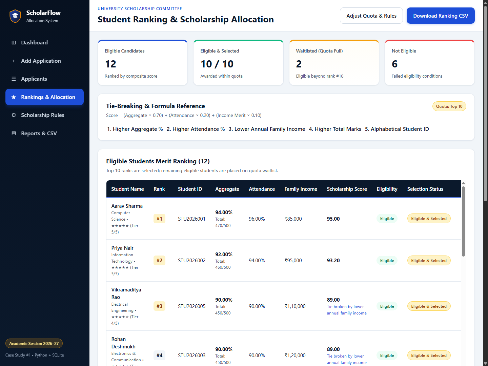
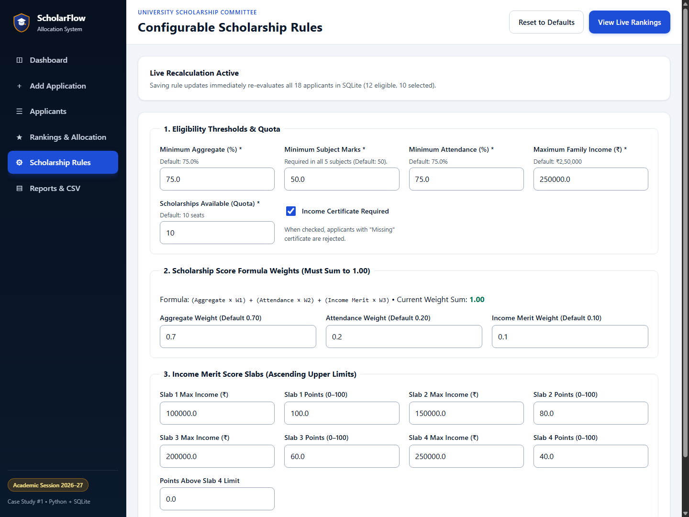
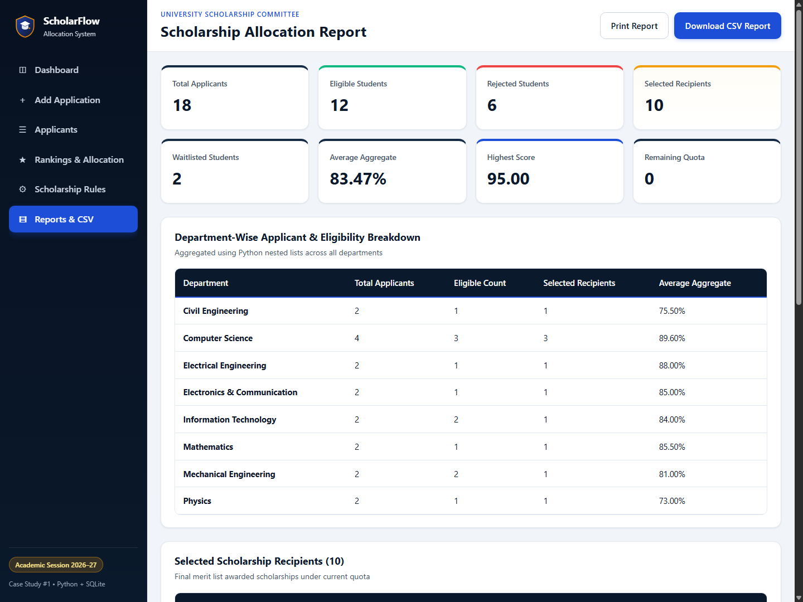
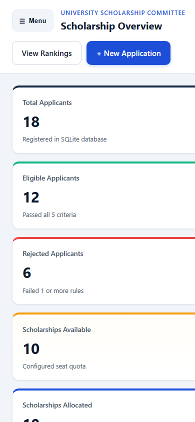

# Output Screenshots

Real application screenshots captured from the live University Scholarship Allocation System (`http://127.0.0.1:5000`):

1. **Dashboard Overview (Desktop):** 
2. **Add Student Application Form & Live Preview:** 
3. **Applicant Management & Filters:** 
4. **Student Evaluation Profile & Award Banner:** 
5. **Rankings, Tie-Breaking & Rejected Reasons:** 
6. **Configurable Scholarship Rules:** 
7. **Analytics & Printable Reports:** 
8. **Mobile Responsive View (390×844):** 
