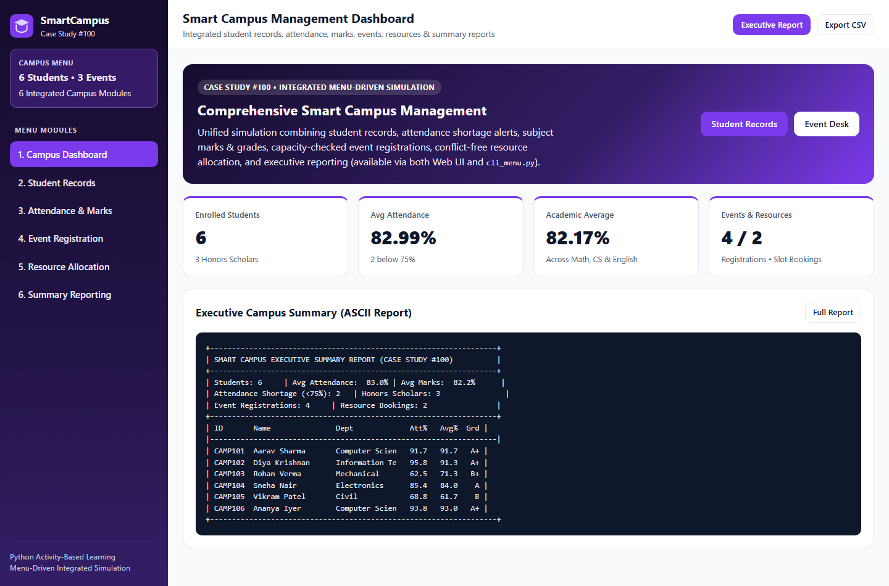
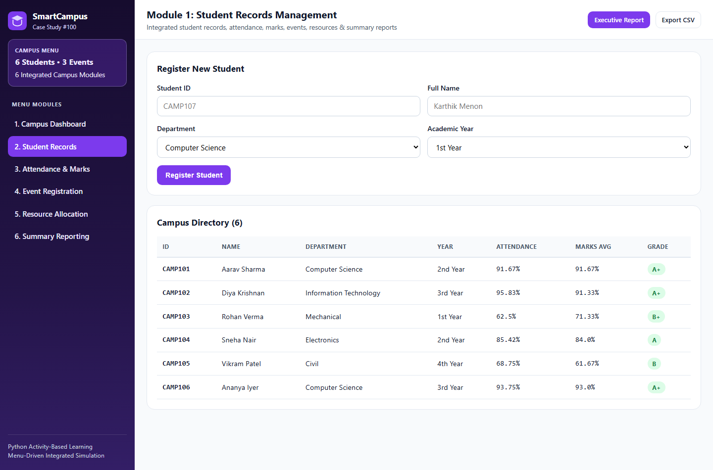
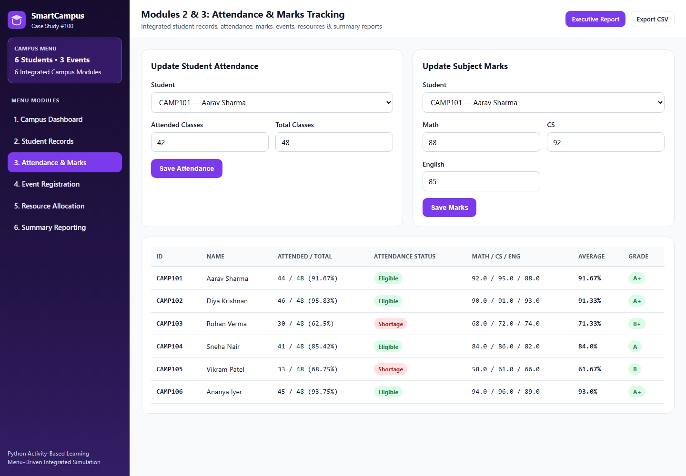
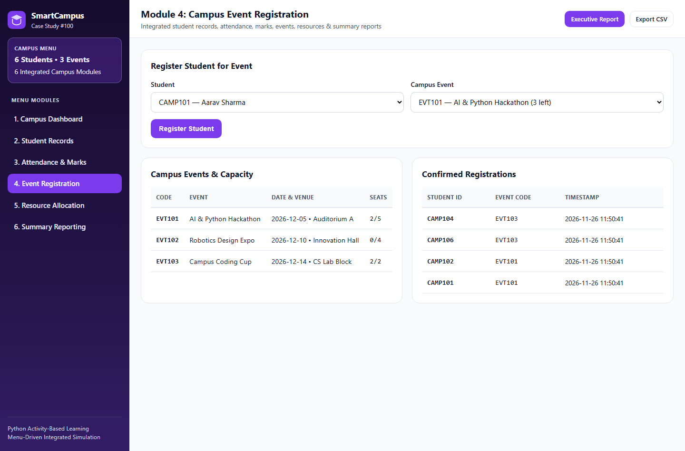
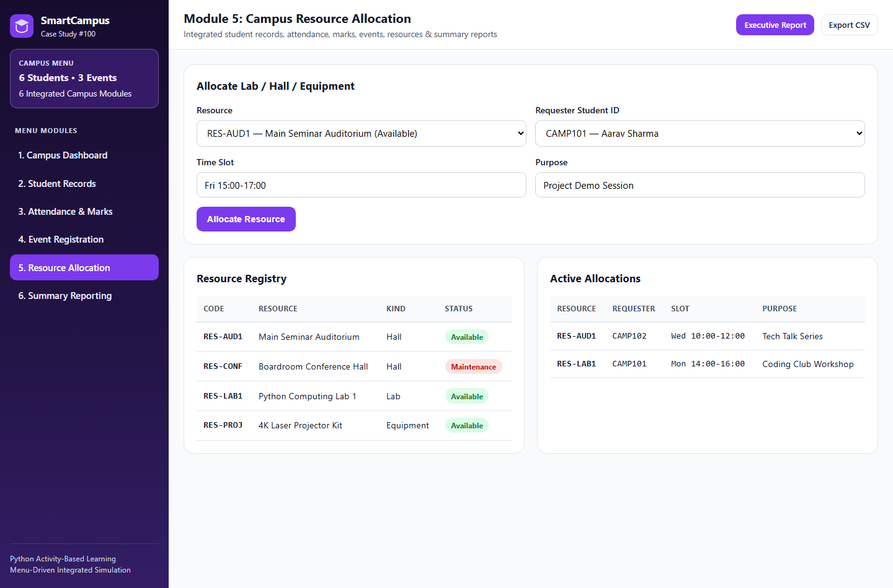
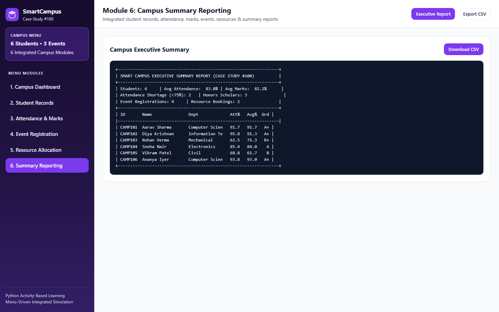
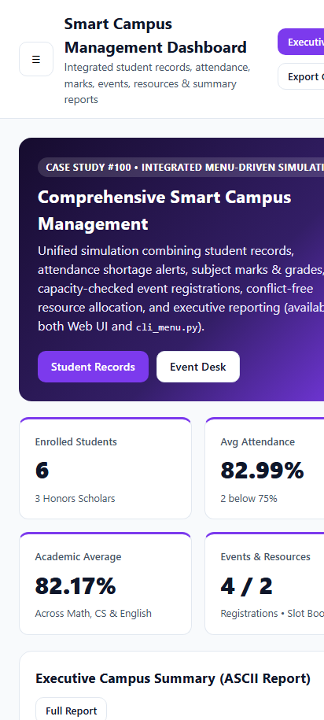

# Output Screenshots — smart-campus-system

## 01_dashboard.png (`/`)

## 02_students.png (`/students`)

## 03_academics.png (`/academics`)

## 04_events.png (`/events`)

## 05_resources.png (`/resources`)

## 06_reports.png (`/reports`)

## 07_mobile_dashboard.png (`/`)

