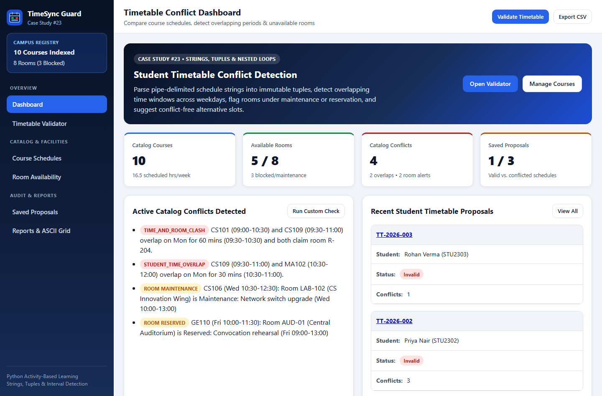
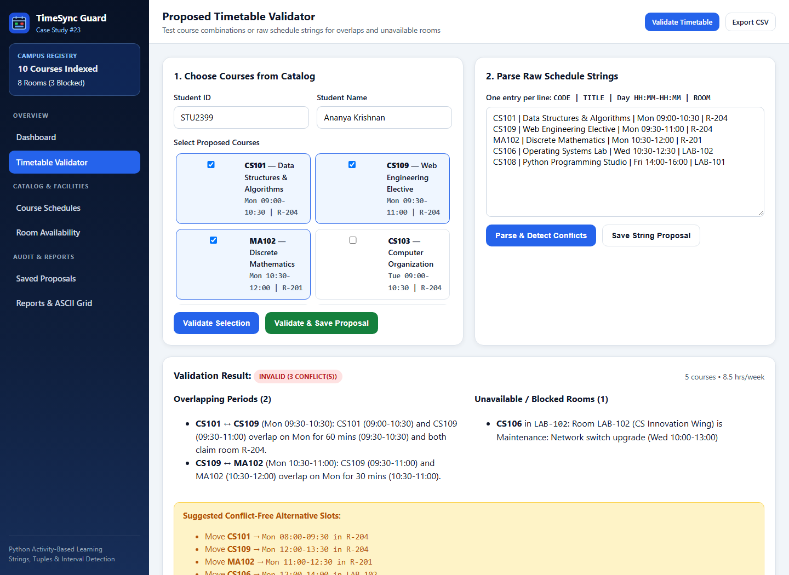
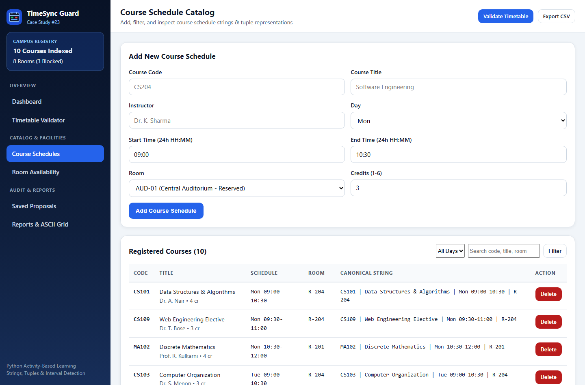
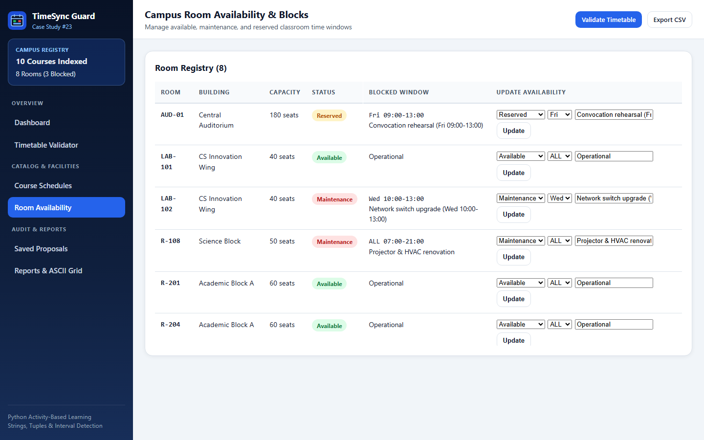
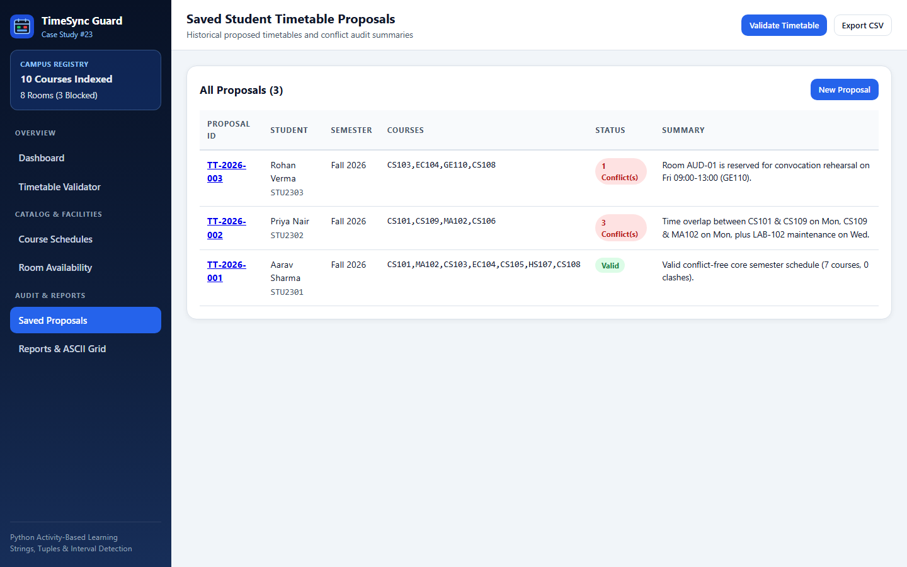
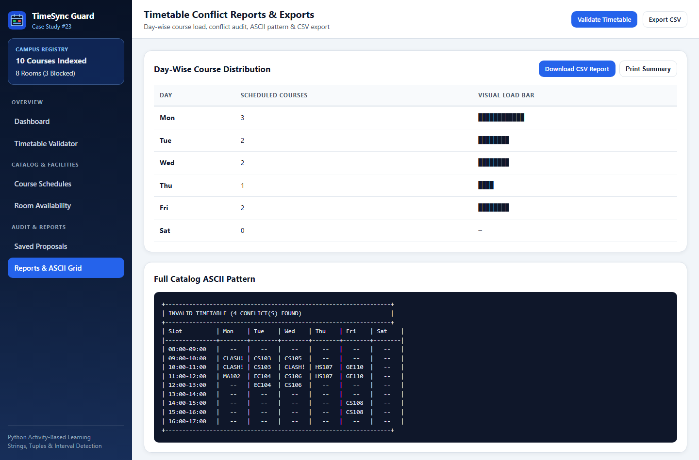
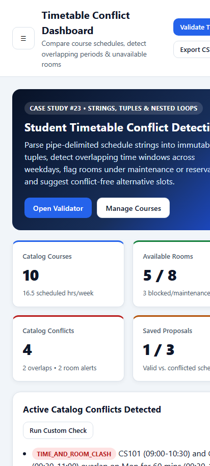

# Output Screenshots — timetable-conflict-system

## 01_dashboard.png (`/`)

## 02_validator.png (`/validator`)

## 03_courses.png (`/courses`)

## 04_rooms.png (`/rooms`)

## 05_proposals.png (`/proposals`)

## 06_reports.png (`/reports`)

## 07_mobile_dashboard.png (`/`)

